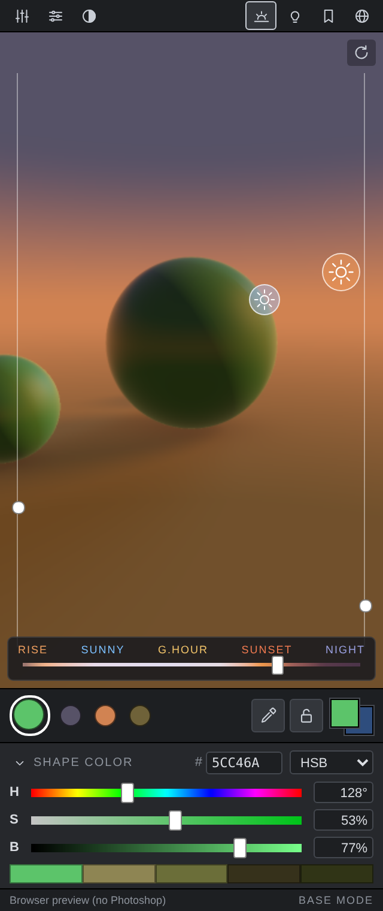

# Chroma Picker for Photoshop

A UXP panel for Photoshop that picks colors under light. You choose a base color and see it on a lit sphere or cube, with a key light and a sky / horizon / ground environment. You can then send the lit shades (highlight, midtone, shadow, bounce) straight to Photoshop's foreground and background colors.

Inspired by the idea behind colgart's Chroma Space. This is an independent implementation with its own code and no shared assets.

## Workspace

From top to bottom, the panel is laid out as one workspace:

1. **Tool row** (one slim row at the top). Settings open as popovers that float over the view.
   - Left: the layout icon opens the scene and material settings (Sphere, Trio or Cube; sheen, shadow softness, specular, reflectivity, subsurface, depth fog, contrast, toon and chrome). The sliders icon floats the color controls over the bottom of the view. The half circle toggles **True Color**, a split view against the unlit local color on neutral gray (drag the divider or use the ← → keys).
   - Right: the sunrise icon turns on time of day, which shows a bar along the bottom of the view labeled RISE, SUNNY, G.HOUR, SUNSET and NIGHT. Dragging it moves the sun and recolors the sky, horizon and ground together. The bulb opens the key and fill lights (direction, height, intensity, spot, ambient and each light's color). The bookmark opens lighting setups, built in and your own. The globe opens pinned colors, history with undo/redo, the 3D or Classic layout, the canvas handles toggle, brush size, Photoshop sync, copy hex and .ase/.gpl export.
2. **View**: fills whatever height the panel has. ↻ in its corner resets the camera and lights.
3. **Targets row**: Shape (the large circle), Sky, Horizon and Ground, then the eyedropper, the lock, and Photoshop's foreground and background colors.
4. **Color section**, then a **status bar** showing which target is being edited (BASE MODE, SKY MODE, GROUND MODE and so on).
5. **Responsiveness**: while you drag, the view draws a quick low-resolution frame; the sharp frame is computed in small slices between events and is dropped if anything changes, so dragging never waits on it. The panel re-lays itself out when Photoshop resizes it.

### Details

1. **Lighting**
   - Sky, horizon and ground are three independent colors. Together they form the backdrop and also light the subject: sky fill from above, bounce from the ground below, and a sheen at the edges that picks up the horizon. Shadows on the ground are soft and spread out with distance.
   - The material popover has Sheen and Shadow softness sliders.
2. **Lighting rig**
   - Drag the sun handles (key and fill) around the subject.
   - Click a handle to edit that light's color.
   - The left rail sets the height of the selected light.
3. **Camera**
   - Drag anywhere in the view to orbit.
   - The right rail tilts the camera.
4. **Quick-select targets**: Shape (the large circle), Sky, Horizon and Ground. The color section edits whichever target is selected.
5. **Color section**
   - The header shows the target name, a hex field and the mode menu (HSB, RGB, Lab, CMYK, Hue Cube).
   - The ⌄ button shows the 2D color field.
   - Below that are the channel sliders (the Brush size slider that sets Photoshop's brush tip is in the globe menu).
   - The **lit palette** gives base, highlight, midtone, shadow and bounce colors estimated from the render. Click a color to set the foreground and copy its hex, or Alt-click it to set the background.
6. **Sample, lock and sync**
   - The eyedropper samples a lit shade from the render and sends it to the foreground.
   - The lock keeps the base color when Photoshop's foreground changes.
   - The two squares are Photoshop's foreground and background. Click either one to send the current color to it, and Alt-click the background square to swap them.
   - **X** swaps foreground and background, **D** resets them, and Ctrl/Cmd+Z undoes.

## Requirements

Photoshop 2022 (23.3) or later on Windows or macOS.

## Install

### Option A: the packaged plugin (`dist/ChromaPicker.ccx`)

1. Double-click `ChromaPicker.ccx`. The Creative Cloud desktop app opens and offers to install it. Confirm the warning about a plugin from outside the Marketplace.
2. Restart Photoshop and open **Plugins → Chroma Picker → Chroma Picker**.

If Creative Cloud will not install an unsigned `.ccx` on your system, use Option B.

You can also install from a terminal with Adobe's UnifiedPluginInstallerAgent (UPIA):

- **macOS**:
  `"/Library/Application Support/Adobe/Adobe Desktop Common/RemoteComponents/UPI/UnifiedPluginInstallerAgent/UnifiedPluginInstallerAgent.app/Contents/MacOS/UnifiedPluginInstallerAgent" --install /path/to/ChromaPicker.ccx`
- **Windows**:
  `"C:\Program Files\Common Files\Adobe\Adobe Desktop Common\RemoteComponents\UPI\UnifiedPluginInstallerAgent\UnifiedPluginInstallerAgent.exe" /install C:\path\to\ChromaPicker.ccx`

### Option B: UXP Developer Tool (always works, best for editing)

1. Install **UXP Developer Tool** from the Creative Cloud desktop app (under All apps, then Developer tools).
2. Turn on Developer Mode when it asks (Photoshop: **Settings → Plugins → Enable Developer Mode**), then restart Photoshop.
3. In UXP Developer Tool, click **Add Plugin** and choose `plugin/manifest.json`.
4. Click **••• → Load**. The panel appears under **Plugins → Chroma Picker**.
5. To make your own `.ccx`, use **••• → Package**.

## Develop

- `plugin/` holds the whole plugin as plain HTML, CSS and JavaScript, with no build step.
- Open `plugin/index.html` in a browser to try the UI with a mock Photoshop.
- Run `node test/unit.js` for the color math, swatch writer and renderer checks.
- Run `node test/browser.js <outdir>` for a Playwright UI smoke test with screenshots.
- `node test/make-icons.js` re-renders the icons.

| File | What it does |
|---|---|
| `js/color.js` | sRGB, HSB, Lab (D50), CMYK, and the picker mode definitions |
| `js/render.js` | Ray-traced lit preview and palette estimation |
| `js/png.js` | PNG encoder (UXP has no reliable canvas pixel API, so images are data URLs) |
| `js/bridge.js` | Photoshop foreground/background, clipboard and file saving, with a browser fallback |
| `js/swatches.js` | `.ase` and `.gpl` writers |
| `js/main.js` | Panel UI and state |
